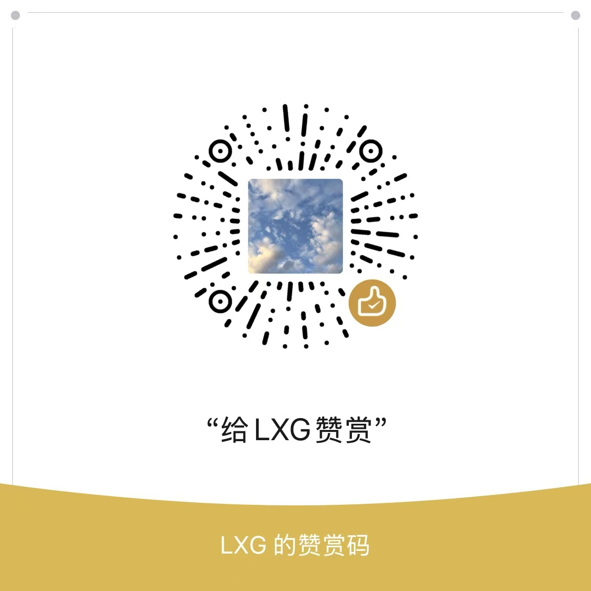

# UI与交互设计准则

一份面向AI辅助开发的精简、框架中立的UI与交互Skill。目标是在实现功能的同时，保持页面布局、操作反馈、移动适配与视觉层级清晰，减少反复返工。

## 来源与维护

本项目由 **liuxiaogang-com** 发起并维护，内容来自其实际项目经验、界面观察与持续积累的UI和交互偏好，经AI辅助整理为可执行的短规则。

这些规则是实践经验与设计取舍，不是通用于所有项目的强制标准。项目明确约束优先，待确认偏好不作为默认强制要求。

唯一发布与更新仓库：https://github.com/liuxiaogang-com/ui-interaction-guidelines

## 文件说明

- `SKILL.md`：供Agent读取的完整规则，包含Skill元数据，可离线使用。
- `README.md`：项目来源、使用方式与更新说明。

公开仓库不包含私人聊天、内部来源记录或凭据。

## 使用方式

### 作为Skill

将本仓库内容放在目标Agent支持的Skill目录下，文件夹名使用 `ui-interaction-guidelines`：

```text
<目标Agent的Skill目录>/
└── ui-interaction-guidelines/
    ├── SKILL.md
    └── README.md
```

不同Agent的安装位置和加载方式可能不同，以其配置为准。本项目不绑定特定Agent、前端框架或组件库。

### 作为上下文

不支持Skill的工具也可以直接读取 `SKILL.md`，或将其内容加入项目上下文。开发、调整或审查界面时，按当前任务选择适用规则。

新项目直接遵守；已有项目调整整体布局及滚动方式前，必须取得明确同意，不得借执行规范擅自重构。

## 更新方式

后续规则更新统一提交到本仓库的 `main` 分支，以Git提交记录追踪变化。

若通过Git克隆安装，在该仓库目录运行：

```bash
git pull --ff-only
```

若手动复制安装，下载最新 `SKILL.md` 后替换本地副本。更新前保留本地自定义内容；发生冲突时先人工核对，不强制覆盖。

目前未提供自动更新器或定时更新任务，也不要求Agent每次执行Skill时联网。仓库内容更新不代表各设备的本地副本已自动更新。

## 支持这个项目

如果这份准则对你有帮助，欢迎点个 Star，也可以通过微信赞赏支持后续整理与维护。感谢支持！



[查看赞赏码原图](assets/donation.jpg)
